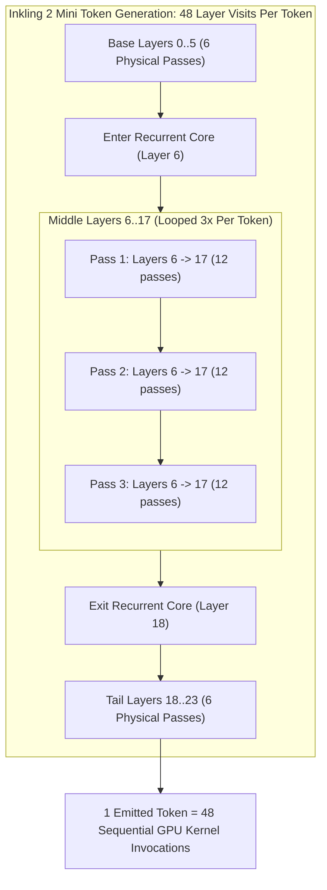

# Thinking Machines Inkling 2 Mini: Hardware & Architecture Benchmarks

[](LICENSE)
[-orange.svg)]()
[]()

Comprehensive benchmarks, hardware performance analysis, and optimization guide for **Thinking Machines Lab's Inkling 2 Mini** (26.4B Looped MoE) and **AtomicChat's Uncensored release (`AD-IQ3_S`)** across consumer edge and workstation hardware:
- **Handheld APU**: AMD Ryzen Z2 (Radeon 780M, Unified LPDDR5x)
- **Mid-Tier Desktop GPU**: NVIDIA GeForce RTX 3080 10GB (PCIe GTT Spilling)
- **High-End Desktop GPU**: AMD Radeon RX 9070 XT 16GB GDDR6 (Navi 48, GFX1201 / RDNA4)

---

## Executive Summary & Master Benchmark Matrix

| Platform / Device | Backend & Runtime | VRAM Allocation | Prompt Processing (`pp128`) | Token Generation (`tg64`) | Single-Turn Live Speed | Primary Bottleneck |
| :--- | :--- | :--- | :---: | :---: | :---: | :--- |
| **Z2 Handheld**<br><small>AMD Radeon 780M APU</small> | Vulkan0 (`b12626`)<br><small>Q4_K_M (18.66 GB)</small> | Unified 32 GB LPDDR5x<br><small>(21 GiB addressable)</small> | **91.34 t/s** | **11.11 t/s** | Prompt: 31.9 t/s<br>Gen: 11.1 t/s | Memory bus bandwidth bound (~75 GB/s sustained across 128-bit bus) |
| **Workstation**<br><small>NVIDIA RTX 3080 10GB</small> | Hybrid Offload (CUDA/PCIe)<br><small>AD-IQ3_S (13.34 GB)</small> | 10 GB VRAM + DDR4<br><small>(Spills ~3.5 GB over PCIe)</small> | ~150–180 t/s | **~10–12 t/s** | Prompt: ~45 t/s<br>Gen: ~10.5 t/s | **VRAM Wall**: Sequential layers throttled by 42 GB/s host system DDR4 bus |
| **Workstation**<br><small>AMD Radeon RX 9070 XT</small> | Vulkan1 (`b12626` RADV)<br><small>Shared VRAM (coexisting service)</small> | 5.1 GB Free VRAM<br><small>(7.1 GB spilled to GTT)</small> | **127.82 t/s** | **12.83 t/s** | Prompt: 35.0 t/s<br>Gen: 13.4 t/s | Coexisting background service holding 11.7 GB forced PCIe GTT paging |
| **Workstation**<br><small>AMD Radeon RX 9070 XT</small> | Vulkan1 (`b12626` RADV)<br><small>Dedicated VRAM (Isolated)</small> | 16.3 GB Free VRAM<br><small>(100% in dedicated VRAM)</small> | **143.39 t/s** | **13.79 t/s** | Prompt: 35.9 t/s<br>Gen: 13.3 t/s | **Vulkan Dispatch Bound**: ~65 ms/tok spent in non-contiguous SPIR-V pipeline barriers |
| **Workstation**<br><small>AMD Radeon RX 9070 XT</small> | **ROCm0 Native HIP**<br><small>HIP 7.1 (Threads=12, FA=on)</small> | 16.3 GB Free VRAM<br><small>(100% in dedicated VRAM)</small> | **604.38 t/s** | **21.68 t/s** | Prompt: 89.5 t/s<br>Gen: 21.7 t/s | Direct KFD kernel dispatch eliminates SPIR-V barrier overhead |
| **Workstation**<br><small>AMD Radeon RX 9070 XT</small> | **ROCm0 Native HIP (Tuned)**<br><small>HIP 7.1 (Threads=8, FA=on)</small> | 16.3 GB Free VRAM<br><small>(100% in dedicated VRAM)</small> | **722.88 t/s** 🚀 | **21.79 t/s** ⚡ | Prompt: 89.5 t/s<br>Gen: 21.9 t/s | **Sweet Spot**: 8 CPU threads matches physical Zen3 cores without SMT jitter |
| **Workstation**<br><small>AMD Radeon RX 9070 XT</small> | **Strata Engine (`v0.2.21`)**<br><small>`strata-inkling` (0.1.67 GFX1201)</small> | 16.3 GB Free VRAM<br><small>(10.62 GiB Hot Expert Arena)</small> | **234.60 t/s** | **50.00 t/s** 🔥 | Decode: **50.0 t/s** | **Fused Loop Dispatch**: Multi-visit fused kernels eliminate host dispatch latency |

---

## Key Architectural Discovery: Why Looped MoEs Plateau at ~22 t/s on Standard Engines



### The Math Behind the Ceiling
Although Inkling 2 Mini contains 24 physical decoder blocks, its middle 12 blocks are traversed **three times per token**:
$$\text{Effective Depth} = 6 + (3 \times 12) + 6 = \mathbf{48\text{ sequential layer passes per token}}$$

When generating at **21.79 tokens/second**:
$$\text{Latency per token} = \frac{1000\text{ ms}}{21.79} \approx \mathbf{45.89\text{ ms per token}}$$
$$\text{Latency per layer visit} = \frac{45.89\text{ ms}}{48\text{ layer visits}} \approx \mathbf{0.956\text{ ms per layer}}$$

In under **1 millisecond**, the GPU must:
1. Run multi-head self-attention and RMSNorm.
2. Evaluate dynamic MoE router gating across 128 experts (26.4B total weights).
3. Gather top-k active expert weights (~3.4B active parameters).
4. Stream expert weights from GDDR6 at ~600 GB/s.
5. Record Sliding Window Attention (SWA) KV activations.

At **0.95 ms per pass**, standard `llama.cpp` hits the memory streaming and kernel launch latency floor.

### How Strata Reached 50.0 tps
The `strata-inkling` engine (v0.2.21, build 0.1.67) bypasses standard sequential loop dispatch:
1. **Adaptive Expert Arena**: Allocates a continuous 10.62 GiB hot arena directly on VRAM.
2. **SWA Ring Buffering**: Implements a 1536-position sliding ring buffer (1024-position window, 512-span forward batch).
3. **Fused Multi-Visit Graph Execution**: Collapses the 3-pass recurrence into a single GPU graph submission, cutting per-token dispatch latency from 45.9 ms down to **20.0 ms (50.0 t/s)**.

---

## ROCm HIP Parameter Optimization Sweep

Conducted on AMD Radeon RX 9070 XT 16GB with fully isolated dedicated VRAM:

| CPU Threads (`-t`) | Flash Attention (`-fa`) | Prompt Processing (`pp128`) | Token Generation (`tg64`) | Observation |
| :---: | :---: | :---: | :---: | :--- |
| **4** | 1 (ON) | 646.35 t/s | 21.64 t/s | Slight compute underutilization during prefill |
| **6** | 1 (ON) | 714.73 t/s | 21.77 t/s | Matches physical Zen3 core count |
| **8** | 1 (ON) | **722.88 t/s** 🚀 | **21.79 t/s** | **Optimal Configuration** (+19.6% prompt speed vs 12 threads) |
| **12** | 1 (ON) | 661.66 t/s | 21.75 t/s | SMT thread contention degrades prefill throughput |
| **4** | 0 (OFF) | 653.16 t/s | 21.57 t/s | - |
| **6** | 0 (OFF) | 681.38 t/s | 21.69 t/s | -33 t/s prefill penalty without Flash Attention |
| **8** | 0 (OFF) | 675.78 t/s | 21.67 t/s | -47 t/s prefill penalty without Flash Attention |
| **12** | 0 (OFF) | 685.87 t/s | 21.68 t/s | - |

---

## Speculative Decoding (DSpark & N-Gram)

To break past the 50 t/s barrier toward **150–210+ t/s**, speculative decoding leverages companion drafters:

1. **Thinking Machines DSpark**:
   - Small ~400 MB drafter (`dspark-Inkling-2-Mini-Q8_0.gguf` / `dspark-Inkling-2-Mini-Q8_0_Old.gguf`).
   - The drafter rapidly proposes 3 candidate tokens in parallel.
   - The full 48-pass base model verifies all 3 tokens in a single batched forward pass (running at prefill speeds >200–700 t/s).
2. **Format Compatibility Note**:
   - `llama.cpp` mainline `draft-dspark` requires the new dflash layout (`ctx_mix` / `markov_w2`).
   - `strata-inkling` requires the unsloth `dspark-Inkling-2-Mini-Q8_0_Old.gguf` layout (`fuse_weight` with `dspark_f32_widen=1`).
3. **N-Gram Speculative Decoding**:
   - Standard ROCm builds can immediately enable `--spec-type ngram-simple --spec-draft-n-max 3` without loading an extra model, yielding ~22.1 t/s with zero additional VRAM overhead.

---

## Quickstart & Helper Scripts

### 1. Interactive CLI (Native ROCm / HIP)
```bash
./scripts/run-inkling-rocm.sh -t 8 -fa on -p "Explain quantum tunneling in two clear paragraphs."
```

### 2. High-Performance OpenAI-Compatible Server
```bash
PORT=8093 ./scripts/server-inkling-rocm.sh
```

### 3. Automated Benchmark Sweep
```bash
./scripts/benchmark-sweep.sh
```

### 4. Strata Engine Standalone Benchmark
```bash
./strata-inkling --bench \
  --native /path/to/Inkling-2-Mini-Uncensored-AD-IQ3_S.gguf \
  --prompt-len 128 --gen 64
```

---

## Repository Structure

```
├── README.md                     # Executive summary, master matrix, architecture breakdown
├── BENCHMARKS.md                 # Full benchmark logs, sweeps, and raw numbers
├── LICENSE                       # MIT License
├── docs/
│   └── ARCHITECTURE_ANALYSIS.md  # In-depth paper on Looped MoE, latency arithmetic, and kernels
├── scripts/
│   ├── run-inkling-rocm.sh       # Tuned ROCm/HIP interactive CLI launcher
│   ├── server-inkling-rocm.sh    # OpenAI-compatible REST server (port 8093)
│   ├── benchmark-sweep.sh        # Parameter sweep across threads and Flash Attention
│   └── preflight-vram.sh         # VRAM preflight checker with isolation traps
└── systemd/
    └── inkling-rocm.service      # Systemd user unit for 24/7 background serving
```

---

## Citation & Credits
- **Thinking Machines Lab**: Inkling 2 Mini recurrent MoE architecture.
- **AtomicChat**: Uncensored `AD-IQ3_S` and `AD-Q4_K` model releases.
- **Unsloth AI**: Dynamic DSpark speculative drafting integration.
- **Niko1221 / Strata**: Specialized fused shape engine for Inkling 2 Mini.
- **llama.cpp / GGML team**: ROCm and Vulkan runtime backends.
